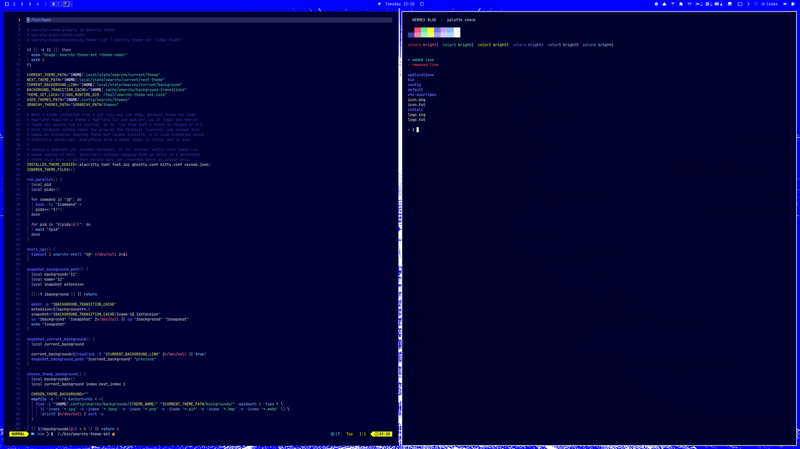
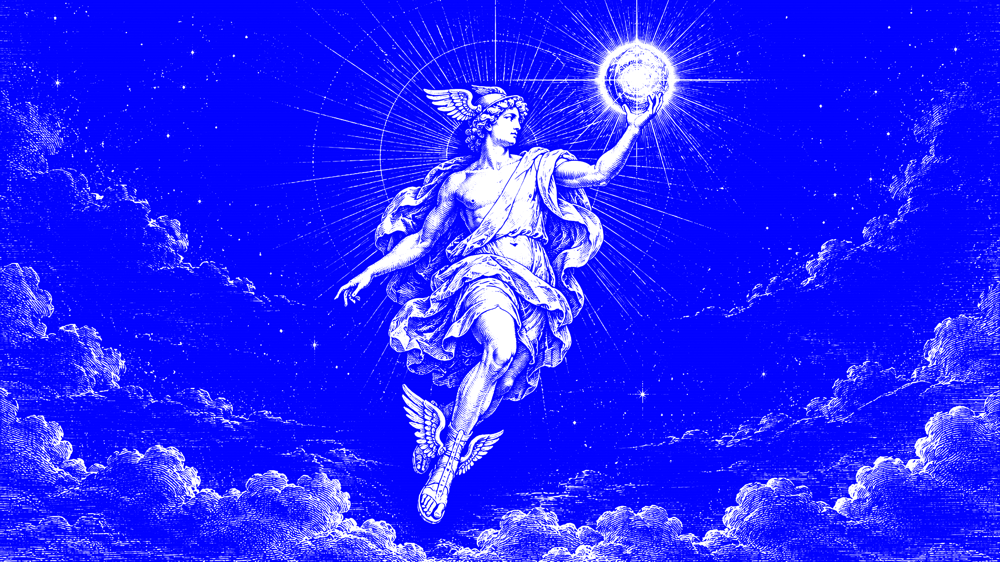
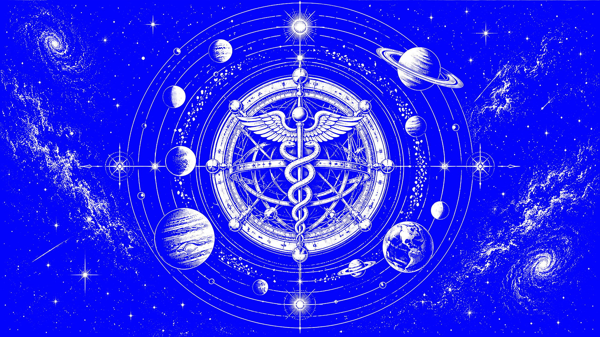
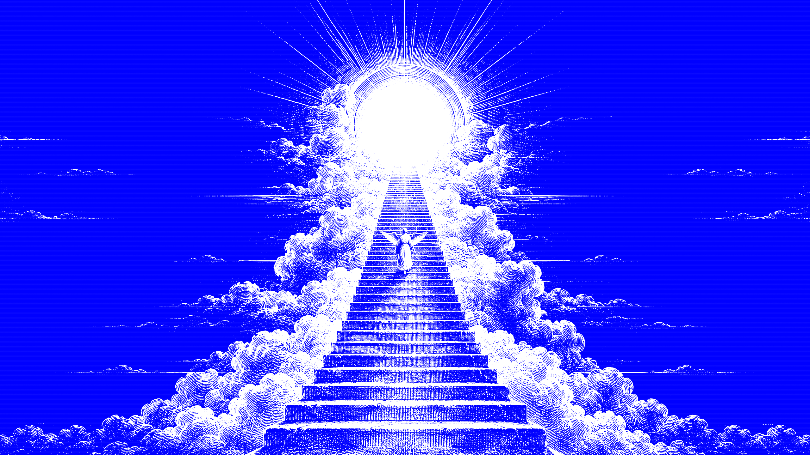
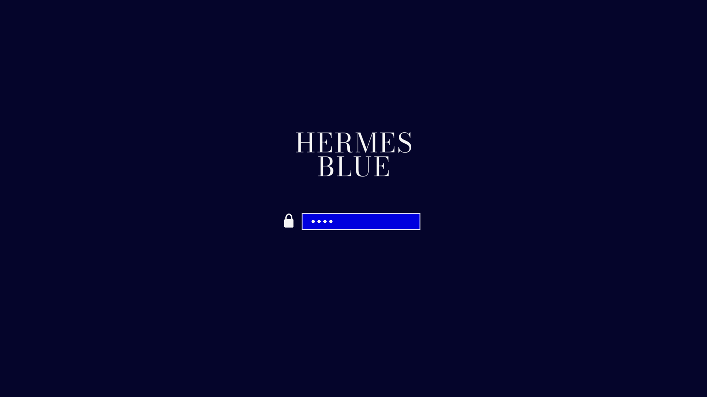

# Hermes Blue

An [Omarchy](https://omarchy.org) theme in an electric-blue poster language:
pure blue bar and wallpapers, deep ink working surfaces, near-white type, square
geometry, and copperplate engraving art.



## Install

```bash
omarchy theme install https://github.com/bryanperdana/omarchy-hermes-blue-theme
```

Or pick it later with `omarchy theme set hermes-blue`.

## Palette

| Role | Color | Where |
| --- | --- | --- |
| Hermes blue | `#0000F2` | Bar, selection, launcher highlight, lock field, wallpapers |
| Ink | `#05052B` | Terminals, editors, menus, notifications |
| White | `#F5F5F5` | Text, active window border |
| Accent | `#7878FF` | Prompts, links, focused text |
| Acid | `#EDFF45` | Rare glint only: yellow, countdowns, bar alerts |

Pure `#0000F2` is kept off text-heavy surfaces on purpose. Blue terminal output
and diffs stay readable on the ink background, while the bar, lock screen and
wallpapers carry the poster identity. Every text color clears 4.5:1 contrast on
the ink background.

## What ships

- `colors.toml` drives terminals, Hyprland, btop, Neovim, VS Code and every
  other app Omarchy themes from its templates.
- `shell.*.toml` are section overrides for the bar, launcher, menu,
  notifications, lock screen and image picker. They merge into the shell config
  Omarchy generates, so new shell options keep their defaults.
- `unlock.png` is the lock screen wordmark.
- `backgrounds/` holds three 2560x1440 engraving wallpapers. Cycle them with
  `omarchy theme bg next`.

## Wallpapers

| Messenger | Orbit | Stairway |
| --- | --- | --- |
|  |  |  |

The wallpapers are original AI-generated images, post-processed into a strict
`#0000F2` / `#F5F5F5` duotone with scanlines and grain.



## Credits

- Visual language inspired by the Hermes Agent desktop site by Nous Research.
  This is an unofficial fan theme, not affiliated with or endorsed by Nous Research.
- Lock screen wordmark set in [Bodoni Moda](https://github.com/indestructible-type/Bodoni)
  (SIL Open Font License 1.1).

## License

MIT
